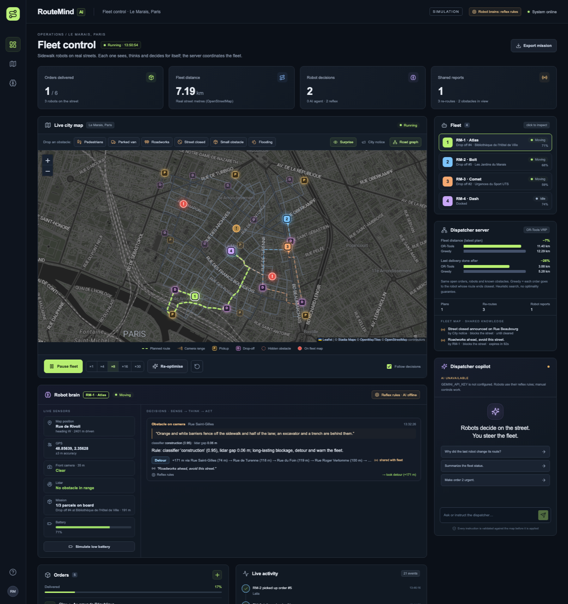

# RouteMind AI

**An AI brain inside every delivery robot.** A fleet of sidewalk delivery robots works on a real city map
(OpenStreetMap). A fleet server dispatches orders across the robots. On the street, each robot senses its
surroundings, reads its map, and an onboard AI agent decides what to do when something gets in the way:
wait, squeeze past, detour, ask the server for help, or go recharge. What one robot learns is shared, so the
rest of the fleet avoids the problem before reaching it.



## How it works

```
                 ┌──────────────── Fleet server (FastAPI) ────────────────┐
  orders ──────▶ │  Dispatcher: OR-Tools pickup-and-delivery VRP          │
                 │      │ plans                ▲ shared fleet map        │
                 └──────┼──────────────────────┼──────────────────────────┘
                        ▼                      │ reports ("roadworks on Rue X")
        ┌──────────── Robot RM-n ─────────────────────────────────┐
        │ SENSE   GPS · front camera (35 m) · lidar gap · battery │
        │ MAP     A* on real streets, detour options with names   │
        │ THINK   AI agent (Gemma) ── reflex rules as safety net  │
        │ ACT     proceed slowly · wait · detour · ask dispatcher │
        │         · return to hub · warn the fleet                │
        └─────────────────────────────────────────────────────────┘
```

1. **Real map.** `backend/data/city.json` is a snapshot of Le Marais, Paris: 397 intersections, 33 km of
   named streets, real restaurants, pharmacies and supermarkets as pickups, and clinics, hotels, banks and
   museums as drop-offs. One command switches to any other city (see below).
2. **Dispatcher.** OR-Tools assigns pickup → drop-off orders to robots. Constraints: the same robot picks up
   and drops off, pickup comes first, at most 3 parcels on board, battery range, and parcels already on board stay with
   their robot. Urgent orders are served early. The dashboard compares every plan with a greedy dispatcher
   on the same orders (sample mission: −7 % fleet distance, last delivery −26 % sooner).
3. **Hidden world.** Obstacles you drop on the map are *ground truth*. No robot and no server knows about
   them until a robot's camera and lidar see one. Each has a camera description, a classifier label with a
   confidence score, and a lidar gap. Some scenes are deliberately ambiguous: the classifier says "person"
   but the description shows workers fencing off a trench.
4. **Robot brain.** When a robot detects an obstacle, it slows down, stops 12 m before it, and builds an
   observation from its own sensors, its mission, its battery, two detour options read from the map with
   street names and extra metres, the fleet's reports, and its memory of earlier decisions. The agent
   returns a structured decision with its reasoning.
5. **Consequences and memory.** If it waits and the obstacle is still there, it decides again, knowing it
   already waited. If it squeezes past a gap that turns out to be too narrow, the bumper stops it and it
   decides again. Outcomes ("cleared after 16 s", "took detour (+156 m)") are written back into memory.
6. **Fleet cooperation.** If the agent shares an obstacle, the server marks the street on the fleet map,
   re-routes every robot whose route crosses it, and the report expires based on the agent's estimate of
   how long it will last. When a robot finds the same obstacle again after the report expired, the fleet
   trusts the new report twice as long. A *City notice* closure is known to the server in advance.

### The agent and its safety net

| Layer | What it does | When |
|---|---|---|
| **AI agent** (`backend/agent.py`) | Gemma reads the full observation and returns JSON: analysis, hazard type, expected duration, action, wait time, detour choice, share flag, radio message | `GEMINI_API_KEY` set |
| **Validation** | Rejects actions that are not offered, detours that don't exist, `proceed_slowly` when the lidar gap is narrower than the robot, `continue` on low battery without enough range | Every AI answer |
| **Reflex rules** | Deterministic autopilot from the classifier label and numbers only | No key, API error, timeout or rejected answer |
| **Safety reflex** | Returns to the hub at 8 % battery without asking | Always |

Every decision on the dashboard says which layer made it (model name and latency, or "Reflex rules"),
and why a fallback happened. The UI never presents a rule as AI output. The AI is useful exactly where the
rules are blind: ambiguous scenes, urgent parcels, a long detour against a short wait, battery margins,
and remembering what already failed.

Calls run in background threads (max 3 at once, `AI_MAX_PARALLEL`), so a robot "thinking" never freezes
the others.

## Run it

Requirements: Python 3.11+ and Node.js 20.19+. Use a **single backend worker**: the simulation lives in memory.

**Windows (PowerShell)**

```powershell
python -m venv .venv
.\.venv\Scripts\python.exe -m pip install -r backend/requirements-lock.txt
Copy-Item .env.example .env
cd frontend; npm.cmd ci; npm.cmd run build; cd ..
.\.venv\Scripts\python.exe -m uvicorn backend.main:app --host 127.0.0.1 --port 8000
```

**macOS / Linux**

```bash
python3 -m venv .venv
.venv/bin/python -m pip install -r backend/requirements-lock.txt
cp .env.example .env
(cd frontend && npm ci && npm run build)
.venv/bin/python -m uvicorn backend.main:app --host 127.0.0.1 --port 8000
```

> If `pip` crashes with `ImportError ... pyexpat ... _XML_SetAllocTrackerActivationThreshold` (a broken
> Homebrew Python on recent macOS), use [uv](https://docs.astral.sh/uv/) instead:
> `brew install uv`, then `uv venv --python 3.13 .venv && uv pip install --python .venv/bin/python -r backend/requirements-lock.txt`.

Open **http://127.0.0.1:8000**. For frontend hot reload keep the backend running and use
`cd frontend && npm run dev`, then open http://127.0.0.1:5173.

The map background uses Stadia Maps' dark tiles (no key needed on localhost) and falls back to Esri's
dark canvas automatically. The street graph overlay comes from the bundled snapshot and works offline.

### Turn on the AI brains

Put a Google AI Studio key in `.env` and restart:

```dotenv
GEMINI_API_KEY=your_key_here
GEMMA_MODEL=gemma-4-26b-a4b-it
```

At startup the backend lists the models available to the key and enables AI only if `GEMMA_MODEL` is among
them. The top bar then shows "Robot brains: gemma-…". Any Gemma or Gemini model your key lists will work.

## Demo script (about 4 minutes)

1. **Load sample mission** in Orders. Six real orders; the dispatcher splits them across three robots and
   keeps RM-4 in reserve. Point at the OR-Tools vs greedy bars.
2. **Start fleet** (×8 is a good speed).
3. Choose **Roadworks** (Surprise mode) and click a street on a robot's dashed route, ahead of it. Say:
   "nobody knows this is here." The camera cone turns amber, the robot stops, and Robot brain shows what it
   saw, what it concluded, its detour and its warning to the fleet. The activity feed shows the server
   re-routing another robot from that report.
4. **Pedestrians** on another route: it waits, then continues ("cleared after … s").
5. **Small obstacle**: it reads the 1 m lidar gap and passes slowly.
6. **Parked van**, then mark that robot's order **urgent**: compare how it weighs waiting against the detour.
7. Switch to **City notice**, then **Street closed**: the fleet re-routes before any robot sees it.
8. **Simulate low battery** on a robot: its agent decides whether the remaining range covers the plan.
9. Ask the **Dispatcher copilot**: "Why did RM-1 change its route?" or "Make order 3 urgent."

## Move the fleet to another city

```bash
.venv/bin/python -m backend.tools.fetch_map --place "Maarif, Casablanca" --radius 650 --name "Maarif, Casablanca"
```

This downloads streets and places from OpenStreetMap (Overpass + Nominatim) and rewrites
`backend/data/city.json`. Restart the backend. `--bbox south,west,north,east` also works.

## Tests

```bash
.venv/bin/python -m pytest backend/tests -q
cd frontend && npm run build
```

22 tests cover:

- **Map and routing:** the real map is connected and named; routing avoids blocked streets; clicks snap to streets.
- **Dispatcher:** pickup comes before drop-off and capacity holds; parcels on board stay with their robot; urgent orders go first; unreachable orders wait; OR-Tools beats greedy on the sample.
- **Robots:** full missions finish without teleporting; obstacles are unknown until the camera sees them; the robot stops before an obstacle to think; pedestrians mean wait then continue; narrow gaps are passed slowly; the bumper fires when a gap closes; city notices re-route robots; low battery wakes the agent and the safety reflex overrides it.
- **AI path, using a scripted fake model:** decisions are applied and shared; the observation holds sensors, map options and memory but **no ground truth**; invalid or failed AI answers fall back to the reflex rules; asking for help re-plans the fleet.
- **Fleet learning:** a re-confirmed report is trusted twice as long; stale private notes never strand a robot.
- **API:** validation works, and the chat states plainly when the AI is unavailable.

## Honest limits

- **It is a simulation.** The world, sensors, battery and speeds are modelled. Camera output is a scene
  description and a classifier label generated from the obstacle, not real image recognition. No physical
  robot is involved.
- **Live Gemma has not been tested yet:** no API key was available during development. The AI path is
  covered by tests with a scripted model, including a slow model running in background threads. Test it
  with your key before the demo.
- OR-Tools uses time-bounded local search: good plans, no optimality guarantee.
- One in-memory mission, one backend process, no authentication.

## Code map

| File | Role |
|---|---|
| `backend/citymap.py` | Loads the OSM graph; A* routing, detour alternatives, street names, click snapping |
| `backend/fleet.py` | The world: robots, movement, sensing, encounters, decisions, fleet map, dispatch calls |
| `backend/agent.py` | Robot brain: prompt, decision schema, validation, reflex rules |
| `backend/dispatcher.py` | OR-Tools pickup-and-delivery VRP and the greedy baseline |
| `backend/hazards.py` | Obstacle catalogue: camera views, classifier labels, gaps, durations |
| `backend/copilot.py` | Dispatcher chat: structured, validated instructions |
| `backend/llm.py` | Google GenAI client, model discovery, structured JSON output |
| `backend/main.py` | HTTP API and the simulation clock |
| `backend/tools/fetch_map.py` | Downloads a city from OpenStreetMap |
| `frontend/src/` | React dashboard: Leaflet map, robot brain, fleet, orders, dispatcher, copilot |

Map data © OpenStreetMap contributors (ODbL).
