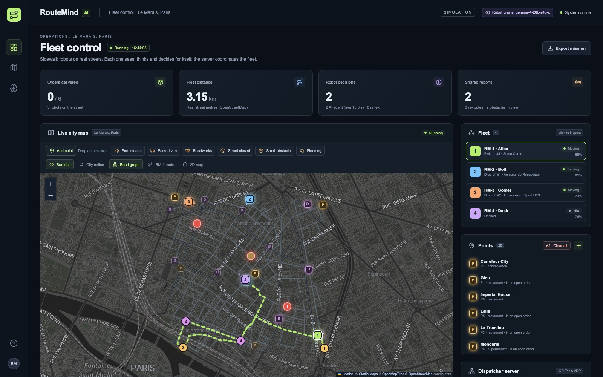
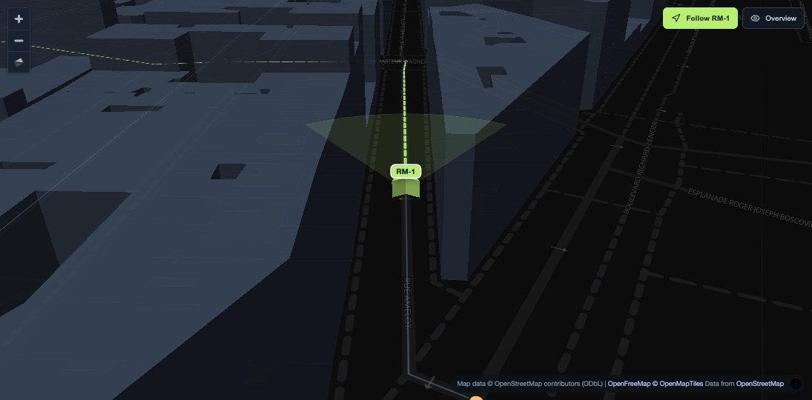
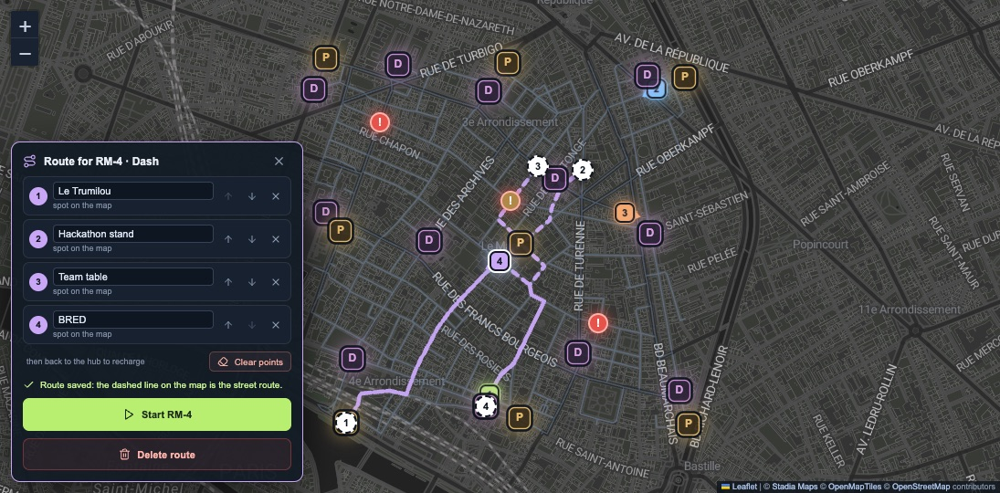
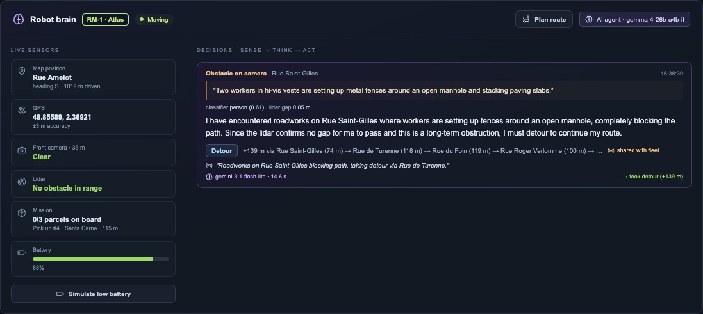
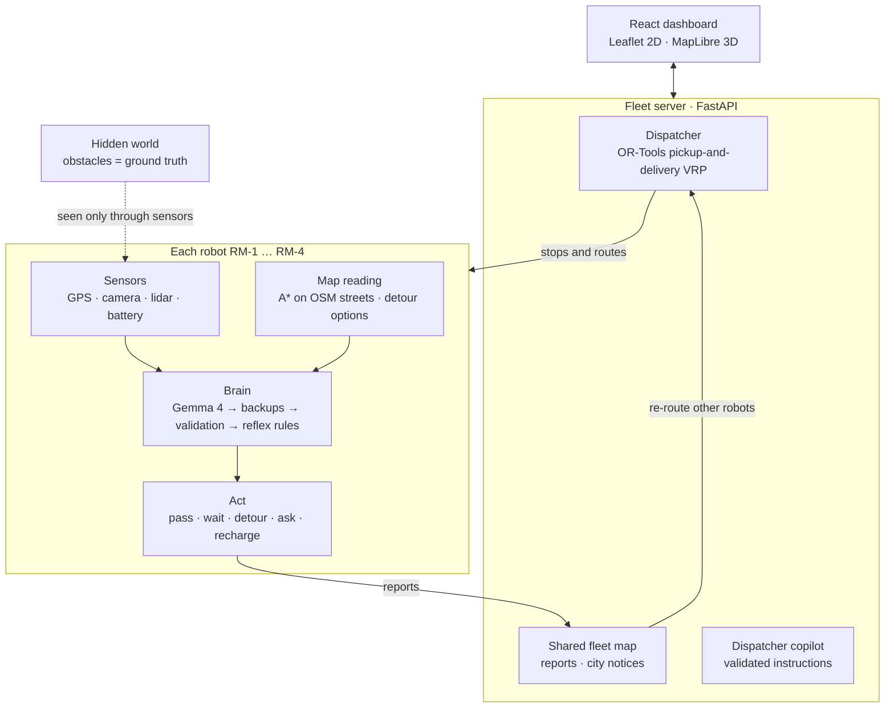

<div align="center">

# 🤖 RouteMind AI

### An AI brain inside every delivery robot

**Sidewalk delivery robots on real city streets. Each robot sees, thinks and decides for itself.<br/>A fleet server dispatches the orders and shares what every robot learns.**




</div>

---

## ⚡ In 30 seconds

Delivery robots struggle when the street changes: roadworks, a crowd, a van parked on the sidewalk. Often they
stop and wait for a remote operator. **RouteMind gives every robot an onboard AI agent.** The robot sees the obstacle with its
camera and lidar, reads its street map to find detours, remembers what it already tried, and decides: wait, squeeze
past, detour, ask the server for help, or go recharge. It explains every decision in plain words and **warns the
rest of the fleet**, so the next robot never drives into the same problem.

- 🗺️ **Real city:** 397 intersections and 33 km of named streets in Le Marais, Paris, from OpenStreetMap
- 🧠 **AI brain per robot:** Gemma 4, with automatic backup models and safety rules underneath
- 🚚 **Smart dispatcher:** Google OR-Tools splits orders across the fleet, −26 % time to the last delivery against a greedy dispatcher
- 🛰️ **Fleet learning:** one robot's report re-routes every other robot
- ✏️ **Operator control:** draw a route for any robot, add your own points, close streets, chat with the dispatcher
- 🏙️ **3D city view:** a chase camera that rides behind a robot as it stops, thinks and turns

---

## 📑 Contents

[Inspiration](#-inspiration) · [What it does](#-what-it-does) · [The robot brain](#-the-robot-brain) ·
[How we built it](#-how-we-built-it) · [Results](#-results) · [Demo script](#-3-minute-demo-script) ·
[Quick start](#-quick-start) · [Challenges](#-challenges-we-ran-into) · [Accomplishments](#-accomplishments-were-proud-of) ·
[What we learned](#-what-we-learned) · [What's next](#-whats-next) · [Prototype scope](#-prototype-scope) ·
[Project structure](#-project-structure) · [Team](#-team)

---

## 💡 Inspiration

Sidewalk delivery robots already deliver in cities and campuses around the world, but they are brittle. They follow a precomputed path, and
anything unexpected (a market closing a street, a delivery van on the sidewalk, a flooded corner) makes them freeze
until a remote operator takes over. Humans handle these moments without thinking: *"that van is unloading, it will
take a few minutes, I'll go around the block."* We wanted robots that reason the same way, and a fleet that
**learns as a team** instead of every robot hitting the same roadblock.

---

## 🚀 What it does

| | Feature | What you see |
|---|---|---|
| 🗺️ | **Real street map** | Robots drive on the real street graph of Le Marais, Paris (OpenStreetMap): real street names, real restaurants, pharmacies and supermarkets as pickups, and clinics, hotels, banks and museums as drop-offs. One command moves the fleet to any city. |
| 🚚 | **Fleet dispatcher** | OR-Tools solves a multi-robot pickup-and-delivery problem: same robot picks up and drops off, at most 3 parcels, battery range, parcels already on board stay put, urgent orders first. Every plan is compared live with a greedy dispatcher. |
| 👁️ | **Hidden world + sensors** | Obstacles you drop on the map are *ground truth*: nobody knows about them until a robot's **camera** (35 m) and **lidar** see them. Each robot also has GPS and a battery model. |
| 🧠 | **AI agent per robot** | When something happens, the robot's brain gets one observation (sensors, map, mission, battery, fleet reports, memory) and returns a decision with its reasoning. See [The robot brain](#-the-robot-brain). |
| 🛰️ | **Fleet learning** | A shared obstacle goes on the fleet map, and the server re-routes every robot whose path crosses it. A report that gets confirmed again is trusted twice as long. |
| ✏️ | **Draw a robot's route** | Pick a robot → **New route** → click points on the map (existing places or any street spot) → rename, reorder, clear → **Save** → **Start**. The robot drives your route, still thinking for itself on the way. |
| 📍 | **Your own points** | Add, rename, retype (pickup ↔ drop-off), delete or clear points. Points used by unfinished orders are protected. |
| 🏙️ | **3D city** | Real 3D buildings, robots as 3D arrows, camera cones, obstacles as blocks, and a **chase camera** that follows the selected robot. |
| 💬 | **Dispatcher copilot** | Ask *"Why did RM-1 change its route?"* or say *"Rue de Turenne is closed for a market."* Every instruction is validated against the map before it is applied. |
| 📊 | **Live dashboard** | Robot brain (sensors + decision log), fleet, orders, dispatcher comparison, shared fleet map, activity feed, mission export. |

<table>
<tr>
<td width="50%"><br/><sub><b>3D city:</b> the chase camera rides behind RM-1, camera cone ahead.</sub></td>
<td width="50%"><br/><sub><b>Route planner:</b> four points saved for RM-4; the dashed line is its street route.</sub></td>
</tr>
</table>

---

## 🧠 The robot brain



**Sense → think → act.** A robot "wakes up" its brain when its camera sees something on the route, when it is
still blocked after waiting, when its bumper stops it, or when its battery gets low. It stops 12 m before the
obstacle and builds one observation:

| The agent receives | Example |
|---|---|
| **Camera** scene description + classifier label + confidence | *"Two workers in hi-vis vests are setting up metal fences around an open manhole"* · `person (0.61)` |
| **Lidar** free gap vs robot width, moving or static | gap `0.05 m`, robot needs `0.8 m`, static |
| **Map reading** two detour options with street names and extra metres | `+139 m via Rue Saint-Gilles → Rue de Turenne → Rue du Foin …` |
| **Mission** parcels on board, urgent orders, next stops | *"Pick up order #4 at Santa Carne (restaurant), 115 m away"* |
| **Battery** range vs metres needed, distance to hub | `range 7530 m · plan needs 3745 m` |
| **Fleet reports** what other robots shared | *"RM-1 · 40 s ago · roadworks on Rue Amelot (blocks the street)"* |
| **Memory** its last decisions and how they turned out | *"Wait and re-scan 15 s → still blocked after 16 s"* |

It answers in structured JSON: analysis, hazard type, expected duration, action (`proceed_slowly`, `wait`,
`detour`, `request_dispatch`, `return_to_hub`, `continue`), detour choice, whether to warn the fleet, and a short
radio message.

### Real decisions from our live runs

> 🅰️ **Ambiguous scene.** The classifier said *person (0.57)*; the camera showed people loading crates into a van parked on the sidewalk. The robot was carrying an urgent order.
> *"I see a parked van with people loading crates on Place de Thorigny, which is blocking the sidewalk and leaving only a 0.21m gap, which is too narrow for my 0.7m robot_width_m. Since I have an urgent parcel to pick up, and this obstacle is likely to take several minutes, I'll take detour option 1 to avoid the delay."*
> **Gemma 4 (26B) · 4.6 s → detour + warned the fleet**

> 🛴 **Cheap obstacle.**
> *"I see a shared e-scooter lying across Rue Beaubourg; the lidar gap of 1.16m is sufficient for my 0.7m robot width plus safety margin. I will proceed slowly to pass the obstacle, as the detour options are significantly more expensive in time and effort for a single stationary object."*
> **Gemma 4 (26B) · 4.2 s → passed slowly, "passed safely"**

> 🔋 **Low battery.**
> *"I am on Rue du Temple with 24% battery, and my current plan requires 2803 m, which is far beyond my current range of 1329 m. I must return to the hub (831 m away) to recharge, as continuing the current plan is impossible without running out of battery."*
> **Gemma 4 (26B) · 3.9 s → returned to hub, released its 2 unpicked orders to other robots**

> 🚧 **Misleading label again.** The classifier said *person (0.61)*.
> *"I have encountered roadworks on Rue Saint-Gilles where workers are setting up fences around an open manhole, completely blocking the path. Since the lidar confirms no gap for me to pass and this is a long-term obstruction, I must detour to continue my route."*
> **Gemini 3.1 Flash Lite (backup model, Gemma was busy) → detour +139 m, warned the fleet**

### Four layers of safety

| Layer | Role |
|---|---|
| **AI agent** | Gemma 4 reasons over the full observation. |
| **Backup models** | If Gemma errors or is slow (12 s), Gemini 3.1 Flash Lite, then Gemini 3 Flash, answer instead. |
| **Validation** | Rejects actions that are not offered, detours that don't exist, passing through a gap narrower than the robot, or continuing on low battery without enough range. |
| **Reflex rules + safety reflex** | Deterministic autopilot when no model can answer; automatic return to the hub at 8 % battery. |

**Honesty is built in:** the agent only ever sees sensor data, never the simulator's ground truth (covered by a
test), and every decision on the dashboard shows which model or rule made it, plus how long it took.

---

## 🛠️ How we built it



| Layer | Built with |
|---|---|
| Robot brains & copilot | **Gemma 4** (`gemma-4-26b-a4b-it`) via the **Google GenAI SDK**, structured JSON output, **Pydantic** validation, Gemini backup models |
| Routing & dispatch | **NetworkX** (A* with a haversine heuristic, k-shortest detours), **Google OR-Tools** (vehicle routing with pickup & delivery, capacity, range, urgency) |
| City data | **OpenStreetMap** via Overpass + Nominatim → our own graph builder (`backend/tools/fetch_map.py`) |
| Backend | **Python 3.13**, **FastAPI**, a thread pool so robots think in parallel without freezing the simulation |
| Frontend | **React 19**, **TypeScript**, **Vite**, **Leaflet** (2D), **MapLibre GL** + **OpenFreeMap** (3D buildings), Stadia Maps tiles, lucide icons |
| Quality | **pytest** (27 tests), a randomised stress run, headless-browser click-throughs |

---

## 📈 Results

| What | Measured |
|---|---|
| Dispatcher vs greedy, sample mission (6 orders, 4 robots) | **−7 % fleet distance** (11.40 km vs 12.29 km) and **−26 % time to the last delivery** (3.88 km vs 5.28 km of driving) |
| AI decision time | **~4 s** with Gemma 4 26B; when Gemma is busy, the backup answers (~15 s including the failed attempt) |
| Robots thinking at once | 3 parallel decisions without rate-limit errors; other robots keep driving meanwhile |
| Robustness | 12 random missions with obstacles, permanent closures, low battery and mid-mission priority changes: every order delivered, except those that permanent closures made unreachable (those wait, with the reason logged) |
| Tests | **27 automated tests**: map and routing, dispatcher constraints, robot behaviour, the AI path (with a scripted model), no ground-truth leaks, backup models, routes, points, API |

---

## 🎬 3-minute demo script

1. **Load sample mission** (Orders panel). Six real orders; the dispatcher splits them across three robots and keeps RM-4 in reserve. Point at the OR-Tools vs greedy bars.
2. **Start fleet** at **×8**.
3. Pick **Roadworks** (Surprise mode) and click a street on a robot's dashed route, ahead of it. *"Nobody knows this is here."* The camera cone turns orange, the robot stops and thinks (purple **?**), and **Robot brain** shows what it saw, what it concluded, its detour and its warning to the fleet. The activity feed shows the server re-routing another robot.
4. **Pedestrians** on another route: it waits, then continues ("cleared after … s"). **Small obstacle**: it passes slowly.
5. Switch to **3D city**: the chase camera follows the robot that is deciding.
6. **Draw a route:** select RM-4 → **New route** → click 3–4 points → **Save** → **Start**.
7. **City notice → Street closed:** the fleet re-routes before any robot sees it. Then **Simulate low battery** on a robot.
8. Ask the **copilot**: *"Why did RM-1 change its route?"*

---

## ⚙️ Quick start

**Requirements:** Python 3.11+ and Node.js 20.19+. Run a **single** backend worker (the simulation lives in memory).

```bash
# 1. Backend environment (macOS: uv avoids broken Homebrew Pythons)
brew install uv                       # or: pip install uv
uv venv --python 3.13 --managed-python .venv
uv pip install --python .venv/bin/python -r backend/requirements-lock.txt

# 2. Frontend
cd frontend && npm ci && npm run build && cd ..

# 3. Configure the AI (optional: without a key the robots use their reflex rules)
cp .env.example .env                  # then put your Google AI Studio key in GEMINI_API_KEY

# 4. Run
.venv/bin/python -m uvicorn backend.main:app --host 127.0.0.1 --port 8000
```

Open **http://127.0.0.1:8000** and wait about 5 seconds, until the top bar says *"Robot brains: gemma-…"*.

<details>
<summary><b>Windows (PowerShell)</b></summary>

```powershell
python -m venv .venv
.\.venv\Scripts\python.exe -m pip install -r backend/requirements-lock.txt
Copy-Item .env.example .env
cd frontend; npm.cmd ci; npm.cmd run build; cd ..
.\.venv\Scripts\python.exe -m uvicorn backend.main:app --host 127.0.0.1 --port 8000
```
</details>

<details>
<summary><b>AI settings (<code>.env</code>)</b></summary>

| Variable | Default | Meaning |
|---|---|---|
| `GEMINI_API_KEY` | (empty) | Google AI Studio key. Without it, every decision is made (and labelled) by the reflex rules. |
| `GEMMA_MODEL` | `gemma-4-26b-a4b-it` | The robots' main model. Any model your key lists works. |
| `AI_FALLBACK_MODELS` | `gemini-3.1-flash-lite,gemini-3-flash-preview` | Tried in order when the main model errors or takes more than 12 s. |
| `AI_MAX_PARALLEL` | `3` | How many robots may wait on the model at once. |

Tip: if Google reports Gemma as busy on demo day, set `GEMMA_MODEL=gemini-3.1-flash-lite` for ~1 s decisions.
</details>

<details>
<summary><b>Move the fleet to another city</b></summary>

```bash
.venv/bin/python -m backend.tools.fetch_map --place "Maarif, Casablanca" --radius 650 --name "Maarif, Casablanca"
```
This downloads streets and places from OpenStreetMap and rewrites `backend/data/city.json`. Restart the backend.
</details>

<details>
<summary><b>Development & tests</b></summary>

```bash
.venv/bin/python -m pytest backend/tests -q      # 27 tests
cd frontend && npm run dev                       # hot reload on http://127.0.0.1:5173 (backend must run)
```
Interactive API docs: **http://127.0.0.1:8000/docs**
</details>

---

## 🧗 Challenges we ran into

- **Making the AI honest.** It is easy to build a demo where the "AI" secretly reads the answer. We split the world into ground truth, the fleet map, and each robot's own knowledge. The agent only receives sensor readings, and a test checks that no hidden field ever reaches the prompt.
- **LLMs are messy.** Models sometimes wrapped the JSON in stray tokens, or invented a place that doesn't exist. We added tolerant JSON extraction, then strict validation against the real map. Invalid instructions are rejected as a whole and never half-applied.
- **Google's endpoints had busy spells during the hackathon** (500s, 503s, timeouts). Instead of hoping, we built a model fallback chain and a deterministic reflex layer, so a robot never freezes because a server is busy.
- **Real maps are not grids.** OpenStreetMap ways had to be split into an intersection graph; places snapped to reachable corners; Overpass rate limits handled with retries.
- **Emergent fleet bugs.** A randomised stress run found robots re-checking a permanently closed street every time its report expired. Now each confirmation doubles how long the fleet trusts that report.

## 🏆 Accomplishments we're proud of

- A robot that **reads a misleading camera label correctly** ("person" → it's actually roadworks) and explains why.
- **Fleet learning that you can watch:** one robot's report re-routes another robot live on the map.
- A dispatcher that **beats a greedy baseline** on both distance and delivery time, with the comparison shown live.
- Graceful degradation: **AI → backup AI → validation → reflex rules**, every layer labelled on screen.
- An operator experience that is fun to use: draw a route, follow a robot in 3D, chat with the dispatcher.

## 📚 What we learned

- The value of an LLM in robotics is **judgement in ambiguous situations**: urgency, cost of waiting vs detouring, memory of what failed. Hard safety limits still belong in code.
- **Structured outputs + validation** make LLM decisions usable in a control loop.
- Classical optimisation (A*, OR-Tools) and LLM reasoning are complementary: one plans globally, the other improvises locally.

## 🔭 What's next

- **Real robots:** run each robot's brain as its own program that connects to the server over the network (WebSocket / ROS 2 bridge); only the sensor source changes.
- **Real perception:** camera frames → a vision model (Gemma is multimodal) instead of simulated scene descriptions.
- **Look-ahead "radar":** scan down each street *at the intersection* before entering it, and use a risk-aware route cost (dead ends, crowds, recent reports, narrow sidewalks), so robots never drive into a dead end.
- **3D physics simulation** (Webots) with a robot model, and robot-to-robot collision avoidance.
- Persistence, authentication and multi-city fleets.

---

## 🧪 Prototype scope

To be clear about what is real and what is simulated:

- **Real:** the OpenStreetMap street network and places, the routing, the OR-Tools dispatcher, the live AI decisions, the fleet-learning logic and the full dashboard.
- **Simulated:** the robots, their sensors (the camera produces a scene description and a classifier label instead of images), battery and speed. No physical robot is connected yet.
- One in-memory mission and one backend process; OR-Tools uses time-bounded search (very good plans, no optimality guarantee).

---

## 📁 Project structure

```
backend/
  fleet.py        the world: robots, movement, sensing, encounters, decisions, fleet map, routes
  agent.py        robot brain: observation prompt, decision schema, validation, reflex rules
  llm.py          Google GenAI client: model discovery, backup chain, tolerant JSON parsing
  dispatcher.py   OR-Tools pickup-and-delivery VRP + greedy baseline
  citymap.py      OSM street graph: A*, detour alternatives, street names, click snapping, custom points
  hazards.py      obstacle catalogue: camera views, classifier labels, lidar gaps, durations
  copilot.py      dispatcher chat: structured, validated instructions
  main.py         HTTP API + simulation clock
  tools/fetch_map.py   download any city from OpenStreetMap
  data/city.json       Le Marais snapshot (works offline)
frontend/src/
  App.tsx                     dashboard layout and interactions
  components/FleetMap.tsx     2D map (Leaflet)
  components/FleetMap3D.tsx   3D city with chase camera (MapLibre)
  components/BrainPanel.tsx   live sensors + decision log
  components/RouteBuilder.tsx draw a robot's route
  components/PlacesPanel.tsx  points: add, rename, retype, delete, clear
```

<details>
<summary><b>API reference</b></summary>

| Endpoint | Purpose |
|---|---|
| `GET /api/map`, `GET /api/state` | City graph and places; live fleet state |
| `POST /api/mission/sample` | Load six real orders |
| `POST /api/orders` · `POST /api/orders/{id}/priority` | Add an order · make it urgent/normal |
| `POST /api/dispatch` | Re-optimise the fleet |
| `POST /api/places` · `PATCH`/`DELETE /api/places/{id}` | Add · rename/retype · delete a point |
| `POST /api/robots/{id}/mission` · `…/mission/start` · `DELETE …/mission` | Save · start · delete a drawn route |
| `POST /api/hazards` · `DELETE /api/hazards/{id}` | Drop an obstacle (surprise or city notice) · remove it |
| `POST /api/robots/{id}/battery` | Simulate a battery level |
| `POST /api/simulation/start` · `pause` · `speed` · `reset` | Simulation control |
| `POST /api/ai/chat` | Dispatcher copilot |
</details>

---

## 👥 Team

| Member | GitHub |
|---|---|
| Hamza Kaddouri | [@HamzaKaddourii](https://github.com/HamzaKaddourii) |
| Mohamed Achraf Anj | |

<!-- Add the rest of the team and each person's role here before submitting. -->

## 📄 License & credits

MIT, see [LICENSE](LICENSE).
Map data © [OpenStreetMap](https://www.openstreetmap.org/copyright) contributors (ODbL). 3D buildings: [OpenFreeMap](https://openfreemap.org) / OpenMapTiles.
2D tiles: [Stadia Maps](https://stadiamaps.com) (Esri fallback). Routing: [Google OR-Tools](https://developers.google.com/optimization), [NetworkX](https://networkx.org).
Robot brains: [Gemma](https://ai.google.dev/gemma) and Gemini via the Google GenAI SDK.
